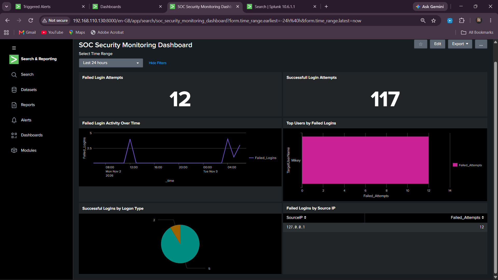

## 📊 SOC Dashboard Preview



# 🛡️ Home SOC Lab – Windows Security Monitoring with Splunk

**A hands-on Security Operations Center (SOC) project demonstrating Windows log monitoring, authentication threat detection, SIEM alerting, and incident investigation using Splunk Enterprise.**


## 📌 Project Overview

This project demonstrates the implementation of a small home-based Security Operations Center (SOC) lab using Splunk Enterprise.

Windows Security Event Logs are collected from a Windows virtual machine using Splunk Universal Forwarder and sent to Splunk Enterprise running on Ubuntu.

The collected logs are analyzed using Search Processing Language (SPL) to identify authentication failures, monitor successful logins, detect suspicious login patterns, and generate alerts.

## 🎯 Project Objectives

- Configure a SIEM environment using Splunk Enterprise.
- Collect Windows Security Event Logs.
- Forward logs using Splunk Universal Forwarder.
- Monitor successful and failed authentication events.
- Detect multiple failed logins followed by successful authentication.
- Configure scheduled alerts.
- Build a SOC monitoring dashboard.
- Perform basic security incident investigation.

## 🏗️ Lab Architecture

```text
        Windows SOC Virtual Machine
        ┌──────────────────────────┐
        │ Windows Security Logs    │
        │                          │
        │ Event ID 4624            │
        │ Event ID 4625            │
        └────────────┬─────────────┘
                     │
                     ▼
        ┌──────────────────────────┐
        │ Splunk Universal         │
        │ Forwarder                │
        └────────────┬─────────────┘
                     │
              TCP Port 9997
                     │
                     ▼
        ┌──────────────────────────┐
        │ Ubuntu Server VM         │
        │ Splunk Enterprise        │
        │                          │
        │ Log Search & Analysis    │
        │ Detection Rules          │
        │ Scheduled Alerts         │
        │ SOC Dashboard            │
        └──────────────────────────┘
```

## 🧰 Tools & Technologies

| Tool | Purpose |
|---|---|
| Splunk Enterprise 10.6.1.1 | SIEM and log analysis |
| Splunk Universal Forwarder | Windows log forwarding |
| Windows Virtual Machine | Security event generation |
| Ubuntu Server 24.04.5 LTS | Splunk server |
| VMware Workstation | Virtual lab environment |
| SPL | Security event searches and detection |

## ⚙️ Implementation

### 1. Splunk Enterprise Setup

- Installed Splunk Enterprise on Ubuntu Server.
- Configured Splunk Web access.
- Enabled receiving on TCP port `9997`.
- Verified connectivity between the Windows and Ubuntu virtual machines.

### 2. Windows Log Collection

Installed Splunk Universal Forwarder on the Windows SOC virtual machine.

Configured the Security Event Log input:

```ini
[WinEventLog://Security]
disabled = 0
index = main
renderXml = true
```

Configured the forwarder to send events to the Splunk server on TCP port `9997`.

### 3. Log Ingestion Verification

Used the following SPL query to verify incoming data:

```spl
index=main
| stats count by host sourcetype
```

Confirmed Windows Security events were successfully received in Splunk.

## 🔍 Detection Rules

### Detection 1: Failed Login Monitoring

**Windows Event ID:** `4625`

Detects failed Windows authentication attempts.

```spl
index=main sourcetype="XmlWinEventLog:Security"
| rex "<EventID>(?<EventCode>\d+)</EventID>"
| rex "<Data Name='TargetUserName'>(?<TargetUserName>[^<]*)</Data>"
| rex "<Data Name='IpAddress'>(?<SourceIP>[^<]*)</Data>"
| search EventCode=4625
| table _time TargetUserName SourceIP EventCode
| sort -_time
```

### Detection 2: Successful Login Monitoring

**Windows Event ID:** `4624`

Monitors successful Windows authentication events.

```spl
index=main sourcetype="XmlWinEventLog:Security"
| rex "<EventID>(?<EventCode>\d+)</EventID>"
| rex "<Data Name='TargetUserName'>(?<TargetUserName>[^<]*)</Data>"
| rex "<Data Name='LogonType'>(?<LogonType>[^<]*)</Data>"
| rex "<Data Name='IpAddress'>(?<SourceIP>[^<]*)</Data>"
| search EventCode=4624 TargetUserName="Mikey"
| table _time TargetUserName LogonType SourceIP
| sort -_time
```

### Detection 3: Multiple Failed Logins Followed by Success

**Detection Name:** Windows - Multiple Failed Logins Followed by Success

This detection identifies successful authentication events preceded by at least three failed login attempts within a rolling five-minute window, grouped by username and source IP.

```spl
index=main sourcetype="XmlWinEventLog:Security"
| rex "<EventID>(?<EventCode>\d+)</EventID>"
| rex "<Data Name='TargetUserName'>(?<TargetUserName>[^<]*)</Data>"
| rex "<Data Name='IpAddress'>(?<SourceIP>[^<]*)</Data>"
| search EventCode=4625 OR EventCode=4624
| sort 0 _time
| streamstats time_window=5m count(eval(EventCode="4625")) as Failed_Logins by TargetUserName SourceIP
| where EventCode="4624" AND Failed_Logins>=3
| table _time TargetUserName SourceIP Failed_Logins
| sort 0 _time
```

**Detection result:** Successfully identified multiple failed login attempts followed by successful authentication for the test account.

## 🚨 Alert Configuration

Configured a scheduled Splunk alert for the correlation detection.

| Setting | Configuration |
|---|---|
| Alert name | Windows - Multiple Failed Logins Followed by Success |
| Schedule | Every 5 minutes |
| Cron expression | `*/5 * * * *` |
| Search window | Last 15 minutes |
| Trigger condition | Number of Results greater than 0 |
| Action | Add to Triggered Alerts |

Verified that the alert appeared in Splunk Triggered Alerts.

## 📊 SOC Security Monitoring Dashboard

Created a six-panel Splunk dashboard to monitor authentication activity.

Dashboard panels:

1. Failed Login Attempts
2. Successful Login Attempts
3. Failed Login Activity Over Time
4. Top Users by Failed Logins
5. Successful Logins by Logon Type
6. Failed Logins by Source IP

## 🔬 Incident Investigation

Performed a controlled authentication investigation by intentionally generating incorrect-password attempts on the Windows lab machine.

**Investigation findings:**

| Attribute | Observation |
|---|---|
| Account | Mikey |
| Source IP | `127.0.0.1` |
| Failed event | 4625 |
| Successful event | 4624 |
| Logon Type | 2 – Interactive |
| Failed attempts | Four in each of two confirmed sequences |
| Detection window | 5 minutes |

The failed authentication events contained:

- Status: `0xc000006d`
- SubStatus: `0xc000006a`

These values were consistent with invalid credentials and an incorrect password.

The successful login events followed the failed attempts by approximately 22 seconds in the two confirmed sequences.

The SYSTEM account also generated Logon Type 5 service logon events, which were distinguished from interactive user logons.

**Investigation conclusion:** The detection and alerting workflow operated successfully in the controlled lab environment. The observed activity was locally generated and does not indicate an external attack.

## 📸 Project Evidence

Screenshots of the lab implementation and investigation are maintained in the `evidence/` directory.

| Screenshot | Description |
|---|---|
| 01 | Failed login detection |
| 02 | Successful login detection |
| 03 | Failed login followed by success correlation |
| 04 | Splunk triggered alerts |
| 05 | SOC security monitoring dashboard |

## 📁 Project Structure

```text
Home-SOC-Lab/
│
├── README.md
│
├── incident-report.md
│
├── evidence/
│   ├── 01-failed-login-detection.png
│   ├── 02-successful-login-detection.png
│   ├── 03-failed-then-success-correlation.png
│   ├── 04-triggered-alerts.png
│   └── 05-soc-security-dashboard-landscape.png
│
└── detection-rules/
    └── authentication-detections.md
```

## 📚 Key Learnings

- SIEM installation and configuration.
- Windows Security Event Log monitoring.
- Splunk Universal Forwarder configuration.
- SPL searches and field extraction using `rex`.
- Authentication event analysis.
- Correlation of failed and successful logins.
- Scheduled alert configuration.
- SOC dashboard creation.
- Basic incident investigation and documentation.

## ⚠️ Disclaimer

This project was created for educational purposes in a controlled home lab environment.

Authentication failures were intentionally generated on the user's own virtual machine to test detection rules and alerting.

The source IP `127.0.0.1` represents local loopback activity. This project does not demonstrate an actual external cyberattack.

---

**Author:** Harsha  
**GitHub:** [Harsh-A7](https://github.com/Harsh-A7)

*Hands-on learning project focused on SOC operations, SIEM monitoring, and security incident investigation.*
